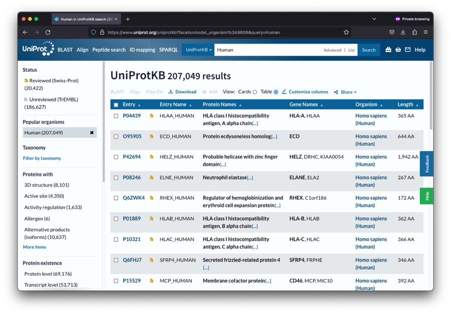
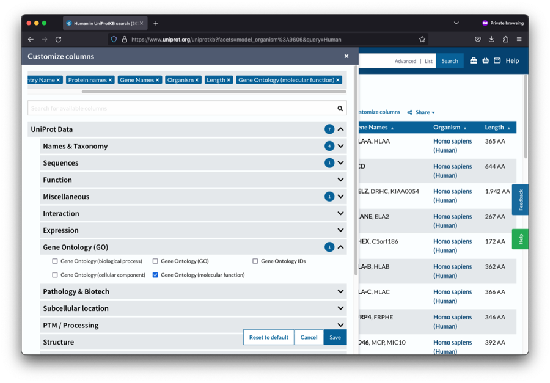

```{r, echo = FALSE}
knitr::opts_chunk$set(collapse = TRUE, comment = "#>")
set.seed(1041)
options(dplyr.print_max = 10)
```

## Introduction

In mass spectrometry-based proteomics, raw search engine outputs (such as from ProteomeDiscoverer, MaxQuant, or FragPipe) often contain minimal metadata—frequently restricted to protein accession identifiers, preliminary gene symbols, or abbreviated descriptions. 

To derive biological meaning from quantitative proteomics data, proteins must be contextualized with richer functional annotations. These include:

- **Gene Ontology (GO)** terms: Molecular Function (*e.g.*, catalytic activity, ion binding), Biological Process (*e.g.*, cell division, DNA repair), and Cellular Component (*e.g.*, mitochondrion, nucleus).
- **Subcellular Localization**: Organelle and compartmental designations.
- **Pathways**: Biological reaction networks from Reactome, KEGG, or WikiPathways.
- **Curated Nomenclature**: Standardized gene symbols and protein descriptions from reference sequence databases.

In `tidyproteomics`, annotations are integral to downstream analysis:

1. **Subsetting & Filtering**: Isolate proteins of interest using semantic queries with `subset()` and the `%like%` operator.
2. **Visual Labeling**: Highlight specific proteins or protein families on volcano plots, PCA plots, and heatmaps.
3. **Term Enrichment Analysis**: Identify statistically over-represented or systematically skewed functional terms via `enrichment()` and `plot_enrichment()`.

This vignette guides you through the process of obtaining new annotations from UniProt or a reference FASTA file, formatting them into tidy tables, importing them into your `tidyproteomics` data object with `annotate()`, and utilizing them in downstream analyses.

```{r, message = FALSE, warning = FALSE}
library(dplyr)
library(tidyr)
library(tidyproteomics)
```

## The Tidyproteomics Annotation Model

Annotations in `tidyproteomics` are structured as a clean, long-format table accessible at `data$annotations`. Every annotation table requires three columns:

1. **Identifier column** (`protein` or `peptide`): Matches `data$identifier`.
2. **`term`**: The category or ontology descriptor (*e.g.*, `'gene_name'`, `'description'`, `'molecular_function'`, `'biological_process'`, `'subcellular_location'`).
3. **`annotation`**: The actual textual term or identifier value.

You can inspect the annotations currently associated with any `tidyproteomics` data object using `show_annotations()`:

```{r}
# Display available annotation categories in the built-in HeLa dataset
hela_proteins %>% show_annotations()
```

To view the raw annotation entries for specific proteins, simply inspect `data$annotations`:

```{r}
hela_proteins$annotations %>%
  filter(protein %in% c('P68431', 'P62805')) %>%
  head(8)
```

---

## Downloading Annotations from UniProt

The **Universal Protein Resource ([UniProt](https://www.uniprot.org))** is the central repository for protein sequence and functional annotation data. The web portal provides an intuitive way to customize and export comprehensive annotation tables for any proteome.

### Step 1: Search for the Proteome of Interest

1. Navigate to [uniprot.org](https://www.uniprot.org).
2. Enter your organism name or taxonomy identifier in the search bar (*e.g.*, `Human` or `taxonomy_id:9606`).
3. On the left filter panel, select **Reviewed (Swiss-Prot)** to filter for high-confidence, manually curated entries (approximately 20,400 proteins for human).

{width="100%"}

### Step 2: Customize Columns for Required Annotations

1. Click the **"Customize columns"** button directly above the results table.
2. In the configuration modal, expand the categories containing annotations relevant to your study:
   - **Gene Ontology (GO)**: Check *Gene Ontology (molecular function)*, *Gene Ontology (biological process)*, and/or *Gene Ontology (cellular component)*.
   - **Subcellular location**: Check *Subcellular location [CC]*.
   - **Function / Pathways**: Check *Pathway*, *Catalytic activity*, or *Keywords*.
3. Click the blue **"Save"** button at the bottom right of the modal to apply the customized view.

{width="100%"}

### Step 3: Download the Data Table

1. Click the **"Download"** button at the top of the search table.
2. Set **Format** to **TSV** (Tab-Separated Values).
3. Choose **Compressed** (gzip) for large datasets or **Uncompressed** for smaller sets.
4. Save the file to your project directory (*e.g.*, `data/uniprot_human_annotations.tsv`).

> **Tip - Programmatic Download via UniProt REST API**:
> You can also download annotations directly within an R script using UniProt's REST API, ensuring complete reproducibility:
>
> ```{r, eval = FALSE}
> # Example: Programmatic download of reviewed human proteins with GO and location terms
> uniprot_url <- paste0(
>   "https://rest.uniprot.org/uniprotkb/stream?",
>   "format=tsv&",
>   "query=%28model_organism%3A9606%29+AND+%28reviewed%3Atrue%29&",
>   "fields=accession%2Cid%2Cgene_names%2Cgo_f%2Cgo_p%2Csubcellular_location"
> )
> download.file(uniprot_url, destfile = "data/uniprot_human_annotations.tsv")
> ```

---

## Tidying Downloaded Annotations

Files exported from UniProt cannot be attached directly without a brief tidying step. Raw UniProt TSVs differ from the `tidyproteomics` specification in several ways:

- The accession column is named **`Entry`** instead of **`protein`**.
- Multi-term fields are concatenated into a single string with semicolons (*e.g.*, `"structural constituent of chromatin [GO:0005488]; protein binding [GO:0005515]"`).
- GO terms and subcellular locations often include accession tags in brackets (*e.g.*, `[GO:0005488]` or `[SL-0191]`), which should be stripped for clean visualization.
- The table is wide (one column per annotation type) and needs to be pivoted to the long three-column format (`protein`, `term`, `annotation`).

### Tidying Workflow

Here is how to read and transform a downloaded UniProt table into the required tidy format:

```{r}
# Example of raw UniProt export data matching proteins in hela_proteins
uniprot_raw <- tibble(
  Entry = c("P68431", "P62805", "P06576", "Q15149"),
  `Gene Ontology (molecular function)` = c(
    "structural constituent of chromatin [GO:0005488]; protein binding [GO:0005515]",
    "structural constituent of chromatin [GO:0005488]; DNA binding [GO:0003677]",
    "ATP binding [GO:0005524]; proton-transporting ATPase activity [GO:0046933]",
    "actin binding [GO:0003779]; structural molecule activity [GO:0005198]"
  ),
  `Subcellular location [CC]` = c(
    "Nucleus [SL-0191]",
    "Nucleus [SL-0191]; Chromosome [SL-0077]",
    "Mitochondrion inner membrane [SL-0168]",
    "Cytoplasm [SL-0086]; Cytoskeleton [SL-0090]"
  )
)

# For your project, load your downloaded file:
# uniprot_raw <- readr::read_tsv("data/uniprot_human_annotations.tsv")

uniprot_raw
```

We now tidy the table:

```{r}
tidy_annotations <- uniprot_raw %>%
  # 1. Rename Entry to 'protein' and select columns of interest
  select(
    protein = Entry,
    molecular_function = `Gene Ontology (molecular function)`,
    subcellular_location = `Subcellular location [CC]`
  ) %>%
  # 2. Split semicolon-delimited entries into separate rows
  separate_rows(molecular_function, sep = ";\\s*") %>%
  separate_rows(subcellular_location, sep = ";\\s*") %>%
  # 3. Remove trailing bracketed accession IDs [GO:...] or [SL-...]
  mutate(
    molecular_function = sub("\\s*\\[.+\\]$", "", molecular_function),
    subcellular_location = sub("\\s*\\[.+\\]$", "", subcellular_location)
  ) %>%
  # 4. Pivot wide annotation columns to the standard term/annotation format
  pivot_longer(
    cols = c(molecular_function, subcellular_location),
    names_to = "term",
    values_to = "annotation"
  ) %>%
  # 5. Remove empty or missing annotations
  filter(!is.na(annotation), annotation != "") %>%
  distinct()

tidy_annotations %>% head(10)
```

The resulting table conforms perfectly to the `tidyproteomics` specification: three columns (`protein`, `term`, and `annotation`).

---

## Importing Annotations with `annotate()`

The `annotate()` function integrates the prepared annotation table into your `tidyproteomics` data object:

```r
data <- data %>% annotate(annotations, duplicates = c("replace", "merge", "leave"))
```

### Managing Duplicate Annotations

The `duplicates` argument controls how new annotations interact with existing ones:

- **`"replace"`** (default): Replaces existing annotations for that `protein` and `term`. Ideal when updating gene symbols or descriptions where only one canonical value is desired.
- **`"merge"`**: Appends new values to existing ones, concatenating multiple terms with a semicolon separator (`"; "`). Ideal for Gene Ontology categories, pathways, or protein domains.
- **`"leave"`**: Appends all new rows without merging, allowing multiple distinct rows for each protein/term pair.

Let's attach the tidied annotations to `hela_proteins` using `duplicates = "merge"`:

```{r}
hela_annotated <- hela_proteins %>%
  annotate(tidy_annotations, duplicates = "merge")

# Confirm the new annotation categories are present
hela_annotated %>% show_annotations()
```

Notice that `subcellular_location` is now available as an annotation category, and `molecular_function` has been augmented with the newly imported terms!

---

## Extracting Annotations from a FASTA File

Search engine outputs often suffer from outdated or truncated gene symbols. A reference FASTA file used during the database search is the authoritative source for sequence headers.

`tidyproteomics` includes an internal parser, `tidyproteomics:::fasta_parse()`, capable of extracting FASTA headers into structured data frames:

```{r}
# Locate the human FASTA file included with tidyproteomics
fasta_file <- path_to_package_data("fasta")

# Parse FASTA headers into a tidy data frame
data_fasta <- tidyproteomics:::fasta_parse(fasta_file, as = "data.frame") %>%
  select(protein = accession, gene_name, description) %>%
  pivot_longer(
    cols = c("gene_name", "description"),
    names_to = "term",
    values_to = "annotation"
  )

data_fasta %>% head(6)
```

We can now use `duplicates = "replace"` to update the `gene_name` and `description` annotations with the exact canonical values from the FASTA database:

```{r}
hela_updated <- hela_proteins %>%
  annotate(data_fasta, duplicates = "replace")

# Compare updated annotations for ATP synthase beta (P06576)
hela_updated$annotations %>%
  filter(protein == "P06576", term %in% c("gene_name", "description"))
```

---

## Utilizing Annotations in Downstream Analyses

Once imported, annotations can be leveraged across all `tidyproteomics` workflows.

### 1. Subsetting by Annotation

Filter datasets based on annotation categories using `subset()` and the `%like%` regular expression operator:

```{r}
# Subset proteins residing in the Nucleus based on newly imported annotations
nuclear_proteins <- hela_annotated %>%
  subset(subcellular_location %like% "Nucleus")

nuclear_proteins
```

### 2. Functional Enrichment Analysis

Term enrichment analyses (*e.g.*, using Wilcoxon rank-sum, GSEA, or Fisher's exact test) test whether specific annotation categories are significantly skewed or over-represented between experimental conditions. Because enrichment algorithms evaluate terms relative to the whole proteome background, `expression()` and `enrichment()` should be performed across the complete dataset (rather than a pre-filtered subset):

```{r, message = FALSE, warning = FALSE, fig.width = 7, fig.height = 4.5}
# Test enrichment of molecular function terms across knockdown vs control
enrichment_results <- hela_annotated %>%
  expression(knockdown/control) %>%
  enrichment(
    knockdown/control,
    .terms = "molecular_function",
    .method = "wilcoxon"
  )

# Visualize the enrichment results
enrichment_results %>%
  plot_enrichment(
    knockdown/control,
    .term = "molecular_function",
    enrichment_min = 0,
    significance_max = 0.05
  )
```

### 3. Exporting Analysis Tables

Export your enrichment results along with corresponding statistical metrics (p-value, adjusted p-value, enrichment score, and term size) for downstream reporting or publication:

```{r}
enrichment_results %>%
  export_analysis(
    knockdown/control,
    .analysis = "enrichment",
    .term = "molecular_function"
  )
```

---

## Summary Checklist

When adding annotations to your proteomics dataset:

1. **Format Requirements**: Ensure your table contains `protein` (or your dataset's identifier), `term`, and `annotation`.
2. **Text Cleaning**: Split multi-value strings (*e.g.*, with `separate_rows()`) and remove bracketed accession codes.
3. **Deduplication Strategy**: Use `duplicates = "replace"` for mutually exclusive terms (*e.g.*, `gene_name`) and `duplicates = "merge"` for additive ontologies (*e.g.*, GO terms, pathways).
4. **Verification**: Always verify your imported annotations with `show_annotations()`.
